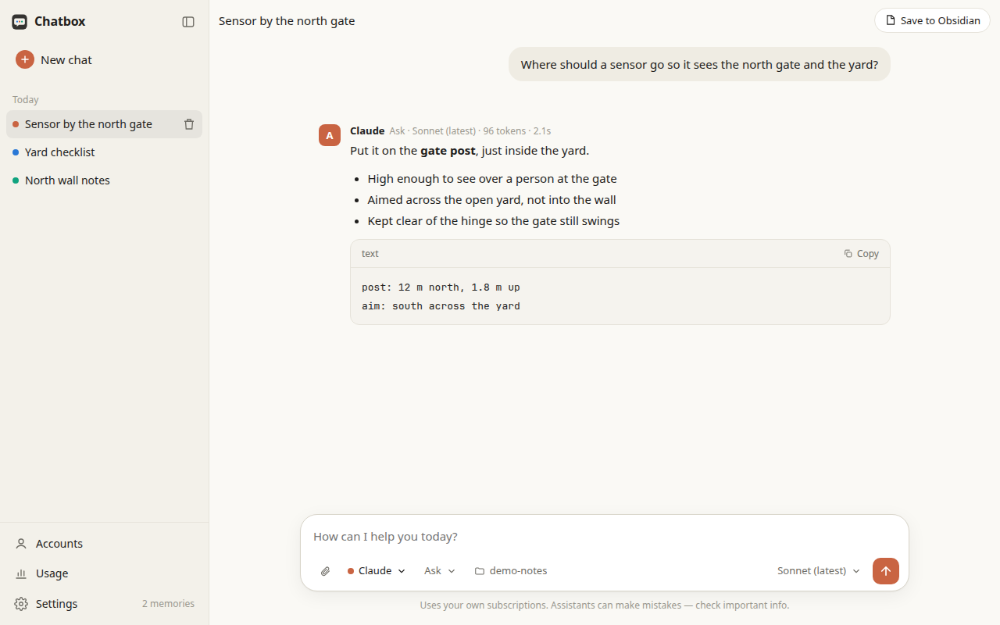
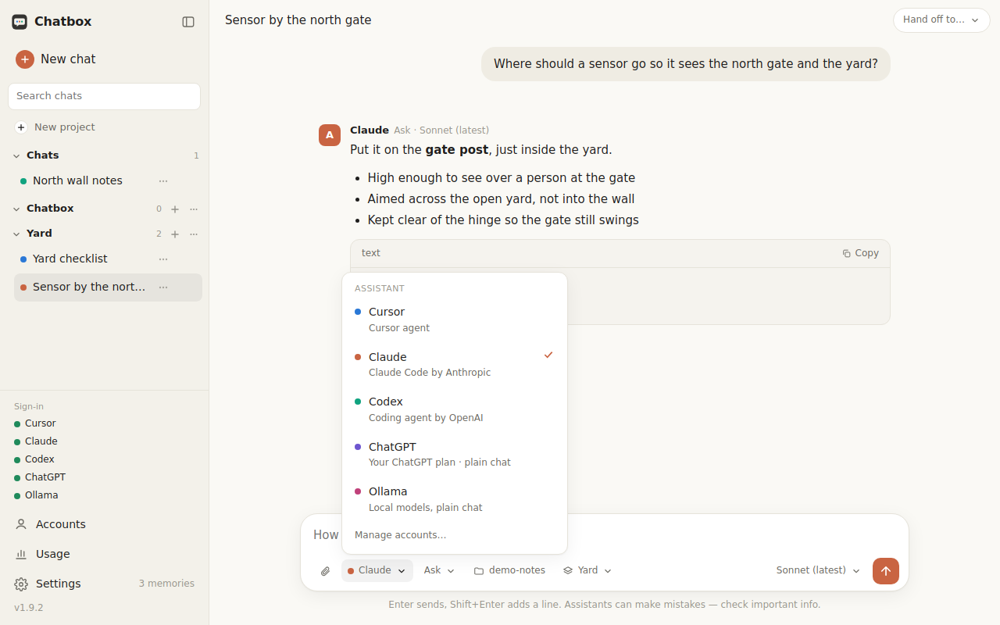
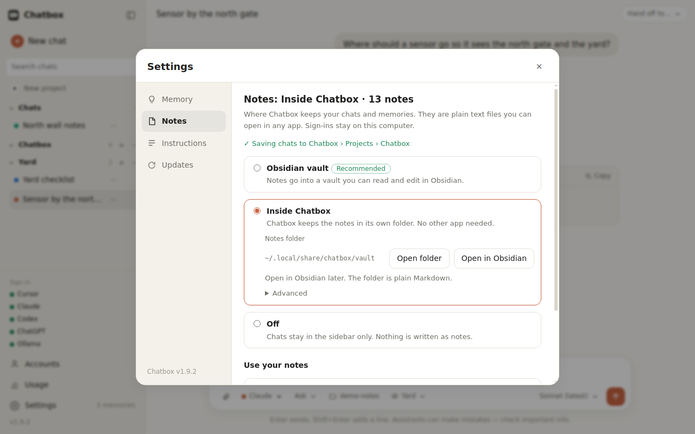
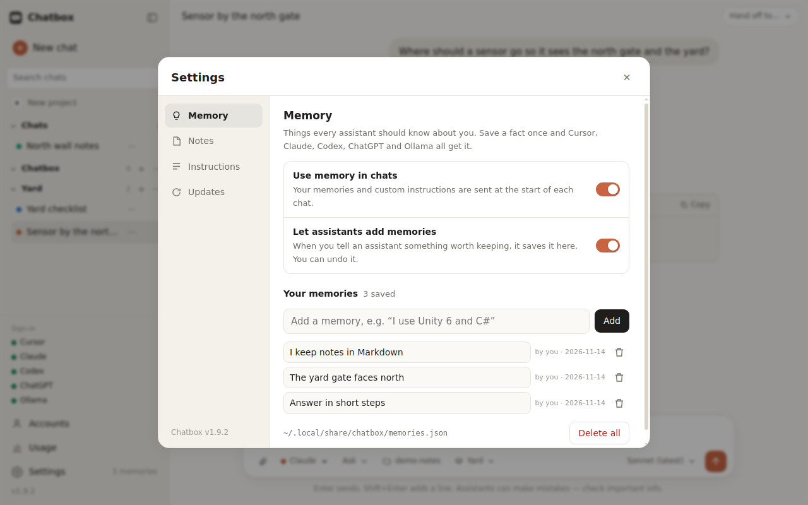

# Chatbox

One chat window for **Cursor**, **Claude**, **Codex**, **ChatGPT** and **Ollama**, using your own subscriptions. No API keys.



The main window, with a short conversation and saved chats in the sidebar.

## What it does

- **All your assistants in one place.** Cursor, Claude, Codex, ChatGPT and local models through Ollama share one window. Switch mid-conversation — each keeps its own part of the chat — hand the conversation to another assistant, or ask several of them the same thing and watch the answers arrive side by side.
- **A normal chat.** Saved chats in the sidebar, replies with headings, lists, tables and code (with a Copy button), and one composer where you pick the assistant, mode, model and folder.
- **Shared memory.** Save a fact once ("I use Unity 6 and C#", "answer in Russian") and every assistant gets it. Custom instructions live in the same place.
- **Your Obsidian vault.** Notes related to your message are found and given to the assistant, memories can live in the vault, and chats can sync through it to your other computers.
- **It checks for updates.** On startup, and about every 6 hours, Chatbox looks for a new version.
- **Linux, macOS and Windows.** Its own window and icon on each.

<table>
<tr>
<td width="50%" valign="top">
<br>
The assistant menu: Cursor, Claude, Codex, ChatGPT, and Ollama.
</td>
<td width="50%" valign="top">
<br>
Settings, with Sync through an Obsidian vault and the Updates section.
</td>
</tr>
<tr>
<td width="50%" valign="top">
<br>
Shared memories in Settings, including the option to keep them in Obsidian.
</td>
<td></td>
</tr>
</table>

## Download

The latest builds are on the [releases page](https://github.com/Artemmie/chatbox/releases/latest).

| System | Download |
|---|---|
| Linux x86_64 | [AppImage](https://github.com/Artemmie/chatbox/releases/latest/download/Chatbox-Linux-x86_64.AppImage) · [tar.gz](https://github.com/Artemmie/chatbox/releases/latest/download/Chatbox-Linux-x86_64.tar.gz) |
| macOS Apple silicon | [disk image](https://github.com/Artemmie/chatbox/releases/latest/download/Chatbox-macOS-arm64.dmg) · [zip](https://github.com/Artemmie/chatbox/releases/latest/download/Chatbox-macOS-arm64.zip) |
| Windows 64-bit | [setup](https://github.com/Artemmie/chatbox/releases/latest/download/Chatbox-Windows-x64-setup.exe) · [zip](https://github.com/Artemmie/chatbox/releases/latest/download/Chatbox-Windows-x64.zip) |

Checksums are `SHA256SUMS` on the same release. `./install.sh` is still there if you would rather run from a git clone (Linux and macOS). Intel Macs are not in the disk image; use `./install.sh` on those.

On the first launch, open **Accounts** and sign in to Cursor, Claude, Codex and ChatGPT. Each tool keeps its own sign-in. Chatbox does not see the password.

- **macOS Gatekeeper.** If the build is unsigned, a double-click is blocked. Right-click `Chatbox.app`, choose **Open**, then Open again. Or run `xattr -dr com.apple.quarantine /path/to/Chatbox.app`.
- **Windows SmartScreen.** If the build is unsigned, choose **More info**, then **Run anyway**.

---

## Install

```bash
git clone https://github.com/Artemmie/chatbox.git
cd chatbox
./install.sh
```

Then open **Chatbox** from your app menu (Linux) or from Applications / Launchpad / Spotlight (macOS). On first start the **Accounts** screen opens: click **Install** and **Sign in** for the services you use.

Options:

| Command | What it does |
|---|---|
| `./install.sh` | Own window. Downloads PyQt6 + Qt WebEngine (~150 MB) into a private venv. |
| `./install.sh --browser` | No extra downloads. Opens Chatbox in your web browser. |
| `./install.sh --distrobox NAME` | Linux only: menu entry runs Chatbox inside a distrobox container. |

Quick try without installing:

```bash
python3 chatbox.py        # opens http://127.0.0.1:8765 in your browser
```

Uninstall with `./uninstall.sh` (your sign-ins and the tools stay).

## Requirements

- Linux with a desktop (tested on KDE Plasma / Wayland), macOS (Apple silicon or Intel), or 64-bit Windows. The Mac install path is checked on GitHub's macOS runners (`install.sh --browser` plus a localhost smoke test). It has not been clicked through on a physical Mac. The Windows unit tests run on GitHub's Windows runners. The packaged apps are smoke-tested there by starting the server and reading the page.
- Python 3.9+ (on macOS: `xcode-select --install`, or python.org / Homebrew)
- A subscription for each assistant you want: Cursor account, Claude Pro or Max, ChatGPT (Plus/Pro, or free with limits)

## The tools it uses

| Assistant | Tool | Installed by the Accounts screen from |
|---|---|---|
| Cursor | `cursor-agent` | `https://cursor.com/install` |
| Claude | `claude` (Claude Code) | `https://claude.ai/install.sh` |
| Codex | `codex` | OpenAI's GitHub releases → `~/.local/bin/codex` |
| ChatGPT | Sign in with ChatGPT (built into Chatbox, no separate tool) | Accounts → Continue with ChatGPT |
| Ollama | Ollama's local server (no command-line tool needed) | Not installed by Chatbox — get it from `https://ollama.com/download` |

If you have the ChatGPT desktop app, Chatbox can also use the `codex` bundled inside it (`ChatGPT.app` on macOS, or set `CHATBOX_CODEX=/path/to/codex` if it isn't found). That copy may be older and accept fewer models. That binary is only for **Codex**. **ChatGPT** chat does not use it.

## How it works

Chatbox doesn't keep an API key. Cursor, Claude and Codex go through their official command-line tools and **your own sign-in**. ChatGPT uses OpenAI's documented [Sign in with ChatGPT](https://developers.openai.com/siwc/token-sharing-open-source) flow for a local open-source app (your ChatGPT plan, still no API key). Ollama stays on your own computer.

```
You type in Chatbox
      │
      ▼
chatbox.py (local server on 127.0.0.1)
      ├── Cursor  → cursor-agent  → your Cursor account
      ├── Claude  → claude        → your Claude Pro/Max subscription
      ├── Codex   → codex         → your ChatGPT account (coding agent)
      ├── ChatGPT → Sign in with ChatGPT → your ChatGPT plan (plain chat)
      └── Ollama  → Ollama's local server (http://localhost:11434) → models on your computer
```

Usage counts toward each service's plan, exactly as if you used its own app. Replies stream in as they are generated. **Stop** cancels the one in progress (or all of them, if you asked several).

## Features

- **Five assistants plus local models**, one window. Assistants that aren't connected are greyed out until you sign in. In the assistant menu, select more than one to ask them together; each answer streams in its own column and **Stop** cancels every one of them.
- **Hand off and compare.** **Hand off to…** switches the chat to another assistant and sends a compact transcript of who said what, including which assistant answered. On a message, **Ask another AI about this** does the same for that turn. **Compare** sends the last question to a second assistant and shows the two answers side by side. Every reply stays labeled with the assistant that wrote it, including in synced Obsidian notes.
- **Streaming replies** – Claude, Cursor, Codex, ChatGPT and Ollama show text as it is produced. If a CLI build can't stream token by token, Chatbox falls back to the next output mode that build supports and still shows the answer when it arrives.
- **Stop and timeouts** – the send button becomes **Stop** while a reply is running and actually kills that request. A CLI that never speaks is stopped after 3 minutes, one that goes quiet after 5, and every turn after 10 (`CHATBOX_START_TIMEOUT`, `CHATBOX_IDLE_TIMEOUT`, `CHATBOX_TIMEOUT`). A missing tool, a signed-out account, or a hang is reported in the chat instead of spinning forever.
- **Files and images** – drop them on the composer or use the paperclip. Cursor, Claude and Codex get the files in the working folder and are asked to read them. ChatGPT (your plan) can take text, images and PDFs. Ollama can take text, and images when that model can see them. A chip on the composer says when a selected assistant can't take a file; that assistant's reply then says so too.
- **Chat history** – every chat is saved and listed in the sidebar (Today, Yesterday, …). Reopen one and keep going: each assistant resumes its own session, in the chat's own folder. A side-by-side question stays grouped.
- **Ask / Plan / Agent** – *Ask* answers and may read files. *Plan* writes an implementation plan and saves it as a Markdown file (`<folder>/plans/…md`) for you to review — nothing is changed yet. Click **Implement plan** to hand it to *Agent*, which edits files and runs commands and ticks off the plan's checklist as it goes.
- **Model picker** – *Auto*, or any model your plan offers (Cursor's list is loaded live).
- **Shared memory** – save facts once ("I use Unity 6 and C#", "answer in Russian") and every assistant gets them at the start of each chat. Add them in **Settings**, type `/remember …`, click **Remember** under any message, or let the assistant save new facts by itself (with **Undo**).
- **Custom instructions** – one place to tell every assistant how to reply.
- **Obsidian as long-term memory** – connect your vault (Accounts → Obsidian; vaults are detected automatically). On first sync Chatbox creates `Home.md`, `Inbox.md`, `Projects/Projects.md` and `Bots/Bots.md` when they are missing, and files each chat under the project it belongs to. Memories live in the Chatbox folder's `Memories.md`. A chat with no project stays in that folder. Editor notes under `Bots/` are created only for assistants you have actually used.
- **Sync through the vault** – Settings → Sync, off until you turn it on. Chats and memories are then stored as Markdown in a folder of the vault (default `Chatbox/`), so Obsidian Sync or iCloud carries them to your other computers. Each chat is one note (`## You`, `## Claude`, …). Sign-ins, tokens and attached file bytes stay on the computer that created them. Chatbox rescans the folder every few seconds. If both computers edit the same chat, new messages are appended; a real clash is saved beside it as `Title (conflict hostname).md` and the other computer's note is left as it was.
- **Usage** – messages, tokens, reply time and (for Claude) cost per assistant and model, with a daily chart and a 7 / 30 day / all-time view. Each reply also shows its tokens, time and cost. Subscription limits aren't visible to the command-line tools, so they aren't shown.
- **Accounts screen** – see what's connected and **Install / Sign in / Sign out** each service without a terminal. Sign-in happens in your browser; Chatbox never sees your password.
- **Local models (Ollama)** – every model you've pulled or built with Ollama (`ollama pull qwen3:8b`, or your own from a Modelfile) shows up in the Model menu. *Auto* uses the one you downloaded or changed most recently. Ask and Plan, no Agent mode. Ollama doesn't remember conversations, so Chatbox keeps each one in `~/.local/share/chatbox/ollama/` and sends the history with every message. Text files are pasted into the message; images are sent only when the model reports vision. The server address (default `http://localhost:11434`, or another computer on your network) is set in Accounts → Ollama.
- **ChatGPT, separate from Codex** – Accounts → **Continue with ChatGPT** is OpenAI's sign-in for open-source apps on this computer. It uses your ChatGPT Plus or Pro plan (no API key) and chats through the public Responses API, with nothing stored on OpenAI's side (`store: false`). It is a plain chat: Ask and Plan, not Agent. Codex remains the coding agent and has its own sign-in. There is no official ChatGPT app you can drive as a general chat CLI without an API key; this sign-in is the supported way to use the plan itself. Chatbox does not scrape the ChatGPT website or reuse browser cookies. The first approval sometimes returns a one-time code OpenAI will not exchange; Chatbox keeps that registration and opens the browser once more so you only confirm the account. If the consent page says a required permission is unavailable, or ChatGPT says this workspace cannot share its plan, Chatbox stops instead of asking again. Accounts then shows that plan use is off, with **Use Codex** and **Sign in again**. Closing the browser ends the attempt and changes nothing. Failures are written to `chatbox.log` without codes or tokens.
- **Desktop app** – its own window and icon: a menu entry on Linux, `Chatbox.app` on macOS, `Chatbox.exe` on Windows. Downloads are above. A git clone can still use `./install.sh` on Linux and macOS.
- **Updates** – on startup, and about every 6 hours, Chatbox checks for a new version. A git install is compared with that clone's tracked branch (`git fetch`, fast-forward only). **Update now** pulls only when that is a straight fast-forward, runs `install.sh` again in the same mode, and restarts. A downloaded app does not replace itself: **Download update** opens the matching file from the GitHub release (the `.dmg`, AppImage, or Windows setup). Chats, accounts and settings are not touched. Turn checks off, or turn on automatic install, in Settings. Automatic install only applies to a clean git clone. If the clone has local edits, or the histories have diverged, Chatbox stops and says so.

## Obsidian layout

Chatbox treats any vault the same way. It does not assume a particular person's folder names.

- `Home.md` links each area (`Inbox`, `Projects`, `Bots`). `Projects/Projects.md` is the only note that links every project.
- A project is `Projects/<Name>.md` until it needs a second note, then `Projects/<Name>/<Name>.md`. Chats are `<title>.md` inside that project's `Chats` folder (`Title (2).md` when the title is already used), with `up: "[[<Name>]]"` and `Back to [[<Name>]]`.
- `Bots/Bots.md` links `Back to [[Home]]`. `Bots/Claude.md` (and Cursor, Codex, ChatGPT, Ollama) appear only after a chat used that editor, and their `%% chatbox:chats %%` section lists recent chats. Ollama model names are grouped on `Ollama.md`.
- The Chatbox hub lists `[[Memories]]` only after `Memories.md` exists. Changing the sync folder exports local chats from `~/.local/share/chatbox/chats/` into the current project folders, and does not copy an id that is already in the vault.
- If Obsidian or the vault folder is missing, Settings says so and offers [Download Obsidian](https://obsidian.md/download) plus **Choose vault folder**. Sync stays off instead of raising.
- Settings → Notes storage has three choices. **Use my Obsidian vault** is recommended. **Keep notes inside Chatbox** uses the same layout in `~/.local/share/chatbox/vault` (plain Markdown, so Obsidian can open it later). **Off** leaves notes out of both. The first launch with no Obsidian app uses the Chatbox folder and shows a short recommendation. Switching to a vault can copy those notes without duplicating ones already there.

## Files

| File | Purpose |
|---|---|
| `chatbox.py` | Local server: chat, history, settings and account APIs |
| `ui/` | The interface: `index.html`, `style.css` and `js/app.js` (no build step) |
| `streaming.py` | Run a CLI, parse its JSON events, cancel it, enforce timeouts |
| `chatgpt.py` | Sign in with ChatGPT and stream the Responses API |
| `attachments.py` | Save dropped files and describe what each assistant can accept |
| `accounts.py` | Status, install, sign-in and sign-out for each command-line tool |
| `memory.py` | Settings, memories and custom instructions |
| `usage.py` | Usage log and summaries for the Usage screen |
| `ollama.py` | Ollama: model list, status, and chats with locally saved history |
| `vault.py` | Obsidian vault: detection, memory note, note search, saving chats |
| `sync.py` | Optional vault sync: Markdown chats and memories, conflict-safe |
| `update.py` | Optional updates: fast-forward a git clone, or link a packaged download |
| `runtime.py` | Data folder, tool lookup, and process control, including Windows |
| `launcher.py` | Packaged entry: a window, or `--no-browser` for the server only |
| `packaging/` | PyInstaller build, optional signing, smoke check |
| `VERSION` | Released version (`MAJOR.MINOR.PATCH`). The packaged app is built with the same number |
| `scripts/next_version.py` | Chooses the next version from commits since the latest tag |
| `SIGNING.md` | How to add the optional Apple and Windows signing secrets |
| `app.py` | Desktop window (PyQt6 WebEngine) |
| `tests/` | `python3 -m unittest discover -s tests` (stdlib only; CLIs are mocked) |
| `install.sh` / `uninstall.sh` | Per-user install, no root needed |

## Privacy & security

- The server listens on `127.0.0.1` only and rejects requests from other websites.
- Chatbox stores no API keys. Cursor, Claude and Codex keep their own sign-in. ChatGPT's OAuth tokens (from Sign in with ChatGPT) are stored only on this computer, in `~/.local/share/chatbox/chatgpt/account.json`, mode `0600`. Sign out clears them and asks OpenAI to revoke the refresh token. You can also disconnect Chatbox in ChatGPT settings.
- In **Agent** mode the assistant can change files in the chosen folder — use it on folders you trust. Files you attach for Cursor, Claude or Codex are copied into `<folder>/.chatbox-attach/` so the assistant can read them.
- ChatGPT chat does not edit files. It can read text, images and PDFs you attach, and those bytes are sent to the Responses API with the message.
- Ollama chats go only to the Ollama address you set (your own computer by default). If you point it at another computer, messages travel over your network unencrypted unless that address uses `https://`.
- With Obsidian connected, notes that match your message are sent to the assistant you are chatting with (turn off in **Settings**). Chatbox only writes inside `Chatbox/` in your vault, plus `plans/` in the project folder you choose.
- Usage statistics are stored locally in `~/.local/share/chatbox/usage.jsonl` (no message text, only counts). Clear them in **Usage**.
- Chats are saved locally in `~/.local/share/chatbox/chats/` (one JSON file each), unless Sync is on, in which case the shared copy is Markdown in your vault. Delete them from the sidebar.
- An update talks only to the git remote you already cloned from, or, when there is no clone, to GitHub's public tag list. It does not send chats, memories or sign-in tokens. It will not download and run a release archive.
- Memories and custom instructions are stored locally in `~/.local/share/chatbox/memories.json` and `settings.json`. With Sync on, memories are also kept in the vault's `Memories.md`. Custom instructions stay on this computer. They are sent only to the assistant you are chatting with, at the start of a chat (or when they change). Turn this off in **Settings**.

## Sync between two computers

Use this when the same Obsidian vault is already synced between the machines (Obsidian Sync, iCloud, Syncthing, or a shared folder).

1. On each computer, connect the vault in Accounts → Obsidian.
2. Open Settings → Sync. Leave the folder as `Chatbox` unless you want a different folder inside the vault. Turn on **Sync chats and memory through the vault**.
3. On the computer that already has chats, click **Move existing chats to sync folder**. This copies them. The originals in `~/.local/share/chatbox/chats/` are not deleted.
4. Wait for the vault to finish syncing, then open Chatbox on the other computer with the same setting. The sidebar picks up new and updated notes within a few seconds. You do not need to restart it.

Sign-ins are not in that folder. Install and sign in to Cursor, Claude, Codex and ChatGPT on each computer. Attached file bytes stay on the computer where you attached them; the note only records the file name.

## Updates

`install.sh` records the clone path, the mode (`window` or `browser`) and any distrobox name in `~/.local/share/chatbox/install.json`. Chatbox uses that to update the same way on macOS (`Chatbox.app`) and Linux (including a distrobox menu entry).

Settings → Updates:

- **Check for updates** is on. Turn it off to stop the startup and 6-hour checks.
- **Install updates automatically** is off. Turn it on to fast-forward and restart when a clean update is waiting and no reply is running.

**Update now** refuses to continue when the clone has uncommitted changes, and it refuses a merge that is not a fast-forward. Nothing in `~/.local/share/chatbox` besides the program files is removed: chats, `settings.json` and `chatgpt/account.json` stay.

## Signing

Signing is optional and happens only when the repository secrets in [SIGNING.md](SIGNING.md) are set. Without them the files are still published.

## Releases

A push to `main` cuts the next release. `scripts/next_version.py` starts from the latest `vX.Y.Z` tag (the number in `VERSION`) and reads the commits after it:

| Commit or pull request title | Bump |
|---|---|
| Contains `BREAKING`, or the subject contains `!:` (`feat!: …`) | major (`1.2.3` → `2.0.0`) |
| `feat:`, a title that starts with `Add`, or the words `new feature` | minor (`1.2.3` → `1.3.0`) |
| Anything else (`fix:`, `docs:`, `chore:`, …) | patch (`1.2.3` → `1.2.4`) |

The highest bump wins. A commit that only changes `*.md`, `docs/**`, or `.github/**` is left out. If every commit since the tag is one of those, or is the version bump itself, there is no release. The bump commit is authored by `github-actions[bot]` and includes `[skip ci]`, so it does not run the workflow again. It writes `VERSION` and tags `vX.Y.Z`. A tag pushed with the Actions token does not start other workflows, so the same job starts the release workflow on that tag (`gh workflow run release.yml --ref vX.Y.Z`). That run checks out the tag, builds the apps, and publishes the release. Release notes are the merged pull request titles since the previous tag.

The packaged build reports the same version. `CHATBOX_VERSION` is the tag, `packaging/build.py` writes `version.txt` from that (or from `VERSION` for a local build), and the update check compares semantic versions: `v1.0.10` is newer than `v1.0.9`.

## Tests

```bash
python3 -m unittest discover -s tests -v
```

GitHub Actions runs that on Ubuntu and macOS. The macOS job also runs `./install.sh --browser` and checks that `Chatbox.app` serves the page on `127.0.0.1`.

## License

MIT
